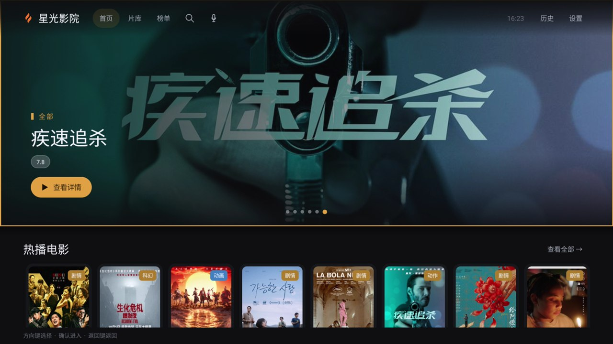
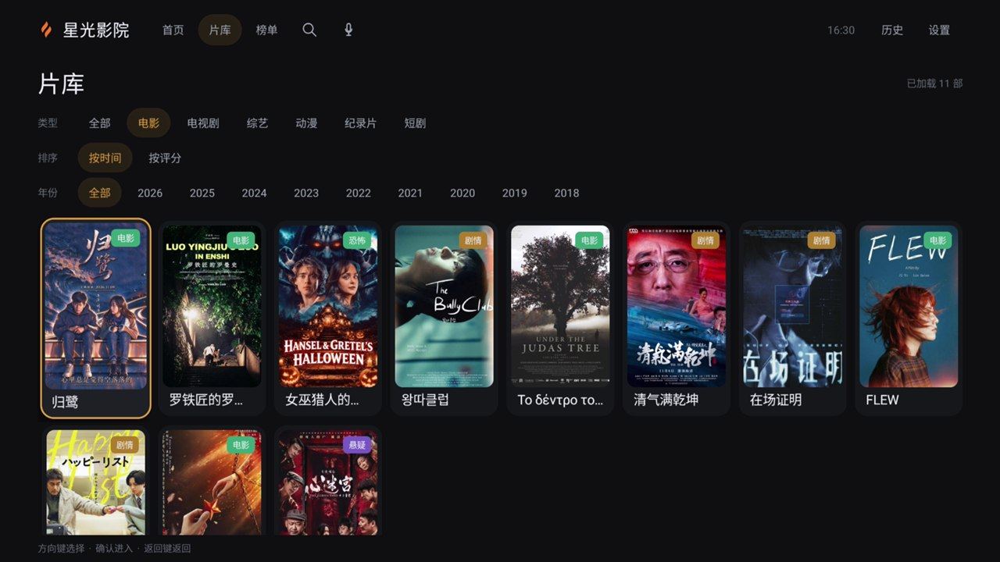
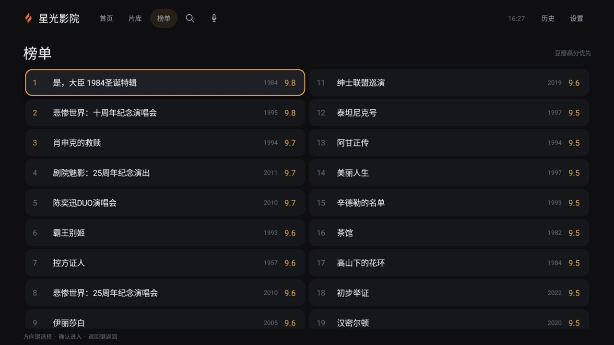
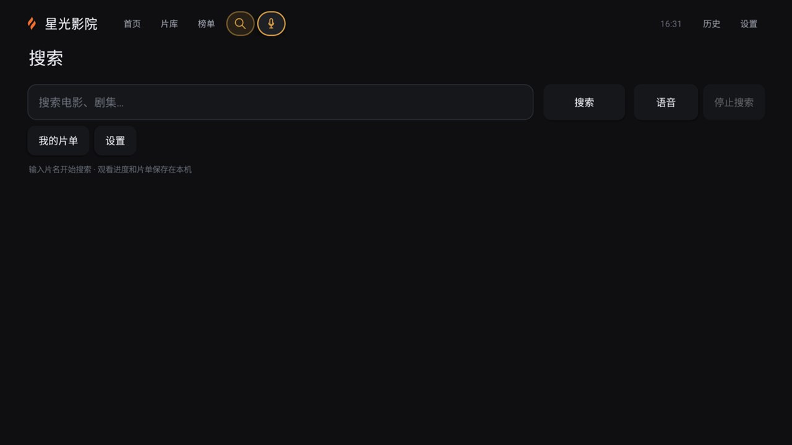
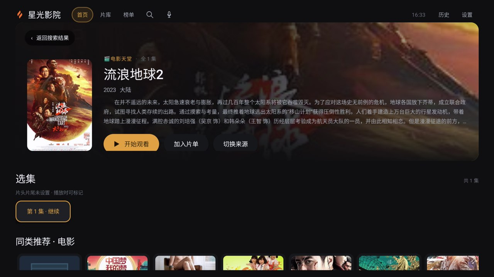
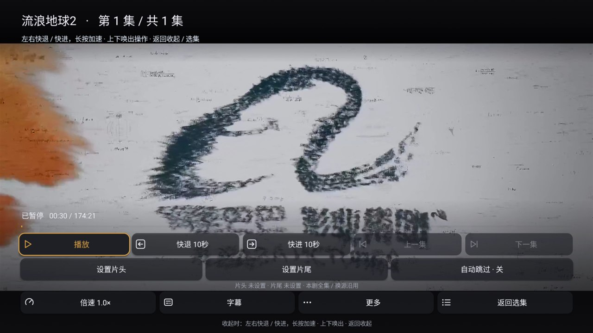
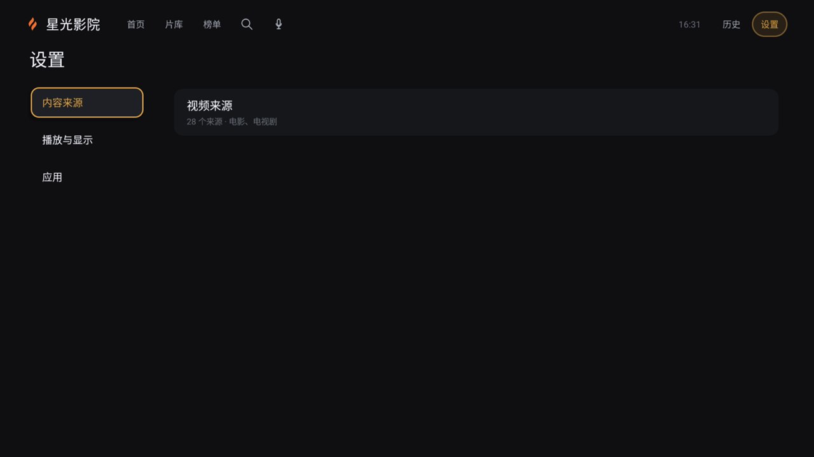

# 星光影院

[](https://github.com/DamionZeng/libretv-all/actions/workflows/android.yml)
[](LICENSE)

> 光落下，故事开始。

适用于 Android 手机、平板、车机与电视的原生影音客户端。Java + Kotlin 编写，播放使用 Media3/ExoPlayer，投屏使用内置 UPnPCast，最低支持 Android 6.0（API 23）。不需要自建服务端：影视来源、搜索、历史、片单与播放进度全部保存在本机。

本仓库不提供任何片源或订阅地址，请自行配置有权访问的 CMS 接口。

## 目录

- [界面预览](#界面预览)
- [功能一览](#功能一览)
- [下载](#下载)
- [构建](#构建)
- [GitHub Actions 自动构建](#github-actions-自动构建)
- [语音搜索](#语音搜索)
- [来源配置](#来源配置)
- [数据与隐私](#数据与隐私)
- [项目结构](#项目结构)
- [文档](#文档)
- [许可与声明](#许可与声明)

## 界面预览

以下截图取自 1920×1080 电视，实际界面随设备、系统与来源不同而变化。

| TV 首页 | 片库 |
| :---: | :---: |
|  |  |
| 全幅轮播与分类横排 | 类型 / 年份筛选，滚动自动加载 |

| 榜单 | 搜索 |
| :---: | :---: |
|  |  |
| 独立页面，高分优先 | 顶部搜索与语音图标，进入默认选中语音 |

| 详情与选集 | 播放控制 |
| :---: | :---: |
|  |  |
| 简介、加入片单、切换来源与选集 | 倍速、字幕、片头片尾与自动跳集 |

| 设置 |
| :---: |
|  |
| 来源、播放与显示、应用设置 |

## 功能一览

**浏览与发现**

- 首页：全幅轮播推荐 + 按分类横排的聚合片库，卡片铺满整行，评分浮层在右下角，类别标签在右上角。
- 片库：基于豆瓣分类接口的聚合片库，支持类型（电影 / 电视剧 / 综艺 / 动漫 / 纪录片 / 短剧）、年份筛选，按时间或评分倒序排列；滚动到底自动加载下一页，没有分页按钮。
- 榜单：独立页面，入口位于顶部导航「榜单」，默认高分优先。
- 片库与榜单只从豆瓣获取片名、年份、评分、类别与海报等展示元数据，不包含任何播放地址；点击条目后仍走本地 CMS 来源搜索，由已有播放链路解析。

**搜索**

- 多源并发搜索，结果边到边显示，可随时停止；单个来源超时或失效不影响其余来源。
- 电视顶部导航提供搜索与语音两个图标入口，位于「榜单」之后；进入搜索页默认选中语音图标，按确认即可开口说话。
- 搜索页保留关键词输入、搜索、语音与停止搜索，以及「我的片单」「设置」快捷入口。

**语音搜索**

- 电视麦克风录音（16 kHz 单声道），说完停顿约 800 ms 自动结束，最长 9 秒。
- 语音转文字与关键词整理都走硅基流动，只需在设置中填写一个 API Key。

**播放**

- Media3 ExoPlayer 播放，支持多线路换源、选集、续播、倍速与字幕。
- 片头片尾按剧名保存在本机：播放器可一键标记片头 / 片尾，同名剧换源沿用，跳片尾前提供 5 秒取消入口，随后遵循「自动下一集」设置。
- 手机手势：单击显示或隐藏控制栏；双击左侧 / 右侧后退 / 前进 10 秒；横向拖动预览目标进度，松手跳转；左侧上下滑动调亮度，右侧上下滑动调媒体音量。
- 电视使用遥控器方向键：焦点高亮、确认播放、左右键快进快退、返回键逐级退出。

**片单与历史**

- 观看历史与「我的片单」均在本机保存，包含海报、进度与来源；可清空历史或移出片单，操作不会删除来源配置。

**投屏（手机）**

- 通过 UPnPCast 发现局域网接收设备，支持单集投屏、队列与批量投屏、播放/暂停/停止、进度与音量控制，并保存投屏记录。
- 能否播放及支持哪些控制取决于接收设备、网络与媒体格式；需要额外请求头的线路会在发送前提示不支持。

**来源与更新**

- 支持粘贴 JSON / 订阅地址导入、手机扫码填写、局域网配对导入；来源可单独启用、停用或删除。
- 启动后每天后台检查一次更新，也可手动「检查更新」；依次尝试 GitHub、Gitee 镜像与公共加速通道，下载后校验大小、SHA-256、包名、版本码与签名再交给系统安装。

## 下载

当前自动构建的安装包固定地址（debug 签名，可直接安装）：

**https://github.com/DamionZeng/libretv-all/releases/download/latest/StarlightTV-latest.apk**

- 发布页：<https://github.com/DamionZeng/libretv-all/releases/tag/latest>
- 每次推送 `main` 都会覆盖这个预发布包；只保留最新一次。
- 推送 `v*` 标签会额外生成正式 Release，附件名为 `StarlightTV-<标签>.apk`。
- 也可以在 [Actions](https://github.com/DamionZeng/libretv-all/actions/workflows/android.yml) 页面下载每次运行对应的 artifact。

> 公开构建使用空来源配置，安装后需要在「视频来源」里自行导入。截图、本地片源目录与签名文件都不会进入仓库。

## 构建

### 环境要求

| 项 | 要求 |
| --- | --- |
| JDK | 17 |
| Gradle | 8.9（随仓库 wrapper 提供，无需单独安装） |
| Android Gradle Plugin | 8.7.3 |
| Kotlin | 1.9.24 |
| Android SDK | Platform 35 与 Build Tools 36.0.0 |
| compileSdk / targetSdk | 35 / 35 |
| minSdk | 23 |

### 构建命令

在仓库根目录执行：

```bash
# 调试包（强制空来源，适合公开分发）
./gradlew -PincludeLocalSources=false :app:assembleDebug

# 单元测试与 Lint
./gradlew -PincludeLocalSources=false :app:testDebugUnitTest :app:lintDebug

# 仪器测试（请使用模拟器或测试机）
./gradlew :app:connectedDebugAndroidTest

# Release 包（需自行配置签名）
./gradlew -PincludeLocalSources=false :app:assembleRelease
```

Windows PowerShell 把 `./gradlew` 换成 `.\gradlew.bat`，例如：

```powershell
.\gradlew.bat -PincludeLocalSources=false :app:assembleDebug
```

`local.properties` 中需要 `sdk.dir` 指向 Android SDK。升级依赖时请同步更新 `app/gradle.lockfile` 与 `third-party/upnpcast/gradle.lockfile`，否则依赖锁定会导致构建失败。

### 产物位置

| 类型 | 路径 |
| --- | --- |
| Debug APK | `app/build/outputs/apk/debug/app-debug.apk` |
| Release APK | `app/build/outputs/apk/release/` |
| 单元测试报告 | `app/build/reports/tests/testDebugUnitTest/` |
| Lint 报告 | `app/build/reports/lint-results-debug.html` |
| 默认来源资产 | `app/build/generated/sourceAssets/` |

### Gradle 属性

| 属性 | 默认值 | 作用 |
| --- | --- | --- |
| `includeLocalSources` | `true` | 是否把 `local/default-sources.json` 打包进 APK；公开构建必须设为 `false` |
| `familyUpgrade` | `false` | 切换为旧包名 `family.libretv.tv`、版本名 `0.21.0-independent`，输出到 `app/build-family-upgrade` |
| `appVersionCode` | `58` | 覆盖 versionCode |

### 签名

Release 包需要自行准备 keystore 并在本机配置签名；公开发布请沿用已有更新签名身份，并保证 minSdk 23 下启用 v1 签名。完整流程（清单生成、SHA-256、双通道验证）见 [发布文档](docs/releasing.md)。

## GitHub Actions 自动构建

工作流文件：[.github/workflows/android.yml](.github/workflows/android.yml)

- 触发：推送到 `main`、推送 `v*` 标签、Pull Request、在 Actions 页面手动运行。
- 环境：`ubuntu-latest` + Temurin JDK 17，使用运行器预装的 Android SDK 安装 Platform 35 与 Build Tools 36.0.0。
- 构建：`./gradlew --no-daemon assembleDebug -PincludeLocalSources=false`。
- 产物：上传 `StarlightTV-<短 SHA>.apk` artifact；`main` 分支同时更新 `latest` 预发布；`v*` 标签生成正式 Release。
- 工作流需要 `contents: write` 权限以创建 Release，仓库默认 Token 即可，无需额外 Secrets。

本地提交并推送即可触发：

```bash
git add -A
git commit -m "你的改动"
git push origin main
```

## 语音搜索

1. 到 [硅基流动](https://cloud.siliconflow.cn) 注册并创建 API Key（按量计费，价格以平台为准）。
2. 电视进入「设置 → 语音搜索」，填入 Key 保存；已保存的 Key 只以掩码回显，界面无法查看明文。
3. 在首页顶部点麦克风图标，或在搜索页确认默认选中的语音图标，直接说话即可。

链路：录音 → 语音转文字 → 整理为影视关键词 → 自动填入并搜索。

| 环节 | 主模型 | 兜底模型 |
| --- | --- | --- |
| 语音转文字 | `XingChenAGI/XingChenASR-V3.2-Ultra` | `XingChenAGI/XingChenASR-Diarize-V3.0` |
| 关键词整理 | `Qwen/Qwen3.5-4B` | `Qwen/Qwen3-8B` |

麦克风权限为可选声明：没有麦克风的设备不影响其它功能，只是无法语音搜索。错误提示会区分 Key 无效（401）、地区限制（403）、额度或频率受限（429）与服务繁忙（503）。

## 来源配置

来源是 Apple CMS 风格的 JSON 采集接口，最小格式：

```json
{
  "sources": [
    {
      "name": "示例来源",
      "url": "https://example.invalid/api.php/provide/vod",
      "enabled": true
    }
  ]
}
```

导入方式：

- 电视「设置 → 视频来源 → 添加来源 / 扫码导入」，粘贴 JSON 或订阅地址；
- 手机「设置 → 影视来源」，填写后通过局域网发送到电视，或扫码在手机上填写；
- 支持逐条启用、停用与删除，删除后搜索不再请求该来源。

本地默认来源：把 `config/default-sources.example.json` 复制为 `local/default-sources.json` 并填入自己的接口，然后正常构建即可打包进 APK：

```bash
./gradlew :app:assembleDebug
```

`local/` 已被 Git 忽略；文件不存在或使用 `-PincludeLocalSources=false` 时生成空来源配置。**包含本地来源的 APK 内含接口地址，请勿公开上传。**

## 数据与隐私

- 所有数据保存在本机 SharedPreferences：来源、历史、片单、播放进度、片头片尾、语音 Key、目录缓存。
- 应用不包含账号体系与统计上报；联网仅用于请求你配置的 CMS 来源、豆瓣展示接口、硅基流动语音接口与更新通道。
- `allowBackup=false`，更新包通过 `FileProvider` 交给系统安装。
- 应用内不播放任何内置内容，片源可用性取决于来源接口与设备解码能力。

## 项目结构

```text
libretv-standalone/
├── app/                                Android 应用模块
│   ├── build.gradle                    编译配置、依赖、prepareSourceAssets
│   └── src/
│       ├── main/java/family/libretv/tv/  业务源码（无子包）
│       ├── main/res/                     图标、主题、播放器布局
│       ├── main/AndroidManifest.xml
│       ├── test/                         JVM 单元测试
│       └── androidTest/                  仪器测试
├── third-party/upnpcast/               内置 DLNA 投屏库（MIT）
├── docs/                               设计与说明文档（docs/wiki 为工程 Wiki）
├── config/                             默认来源配置示例
├── scripts/                            发布与镜像脚本
├── local/                              本地真实来源（Git 忽略）
└── .github/workflows/android.yml       GitHub Actions 构建
```

主要入口：

| 类 | 职责 |
| --- | --- |
| `MainActivity` | TV 入口与调度：搜索、语音、详情、设置、扫码配对 |
| `TvHomeActivity` | TV 首页、片库、榜单、历史 |
| `PhoneActivity` | 手机界面：首页、搜索、历史、片单、设置 |
| `DirectPlayerActivity` | 播放页（Media3） |
| `CatalogRepository` | 豆瓣展示层：首页、片库、榜单 |
| `LocalRepository` | 来源管理、多源并发搜索 |
| `PlaybackStore` | 历史、片单与续播 |
| `VoiceSearch` | 录音、语音转写与关键词整理 |
| `AppUpdater` | 更新检查、下载与校验 |

## 文档

- 工程 Wiki：[docs/wiki](docs/wiki/README.md)（架构、模块、类说明、存储、播放、投屏、更新、构建）
- 发布流程：[docs/releasing.md](docs/releasing.md)
- 兼容说明：[docs/android-compatibility.md](docs/android-compatibility.md)
- 更新历史：[docs/release-notes-0.21.0.md](docs/release-notes-0.21.0.md)

## 许可与声明

- 项目采用 [AGPL-3.0-or-later](LICENSE)，第三方许可与署名见 [NOTICE.md](NOTICE.md) 与 `third-party/upnpcast/LICENSE`。
- 本项目为独立客户端，部分业务设计与解析逻辑参考 LibreTV，不是 LibreTV 官方发行版。
- 仓库只包含程序代码，不提供、不托管、不推荐任何影视资源；请自行配置合法来源并遵守当地法律与内容授权。
- 投屏、语音识别与低版本系统的兼容性需要在对应设备上验收，构建通过不等于真机可用。
