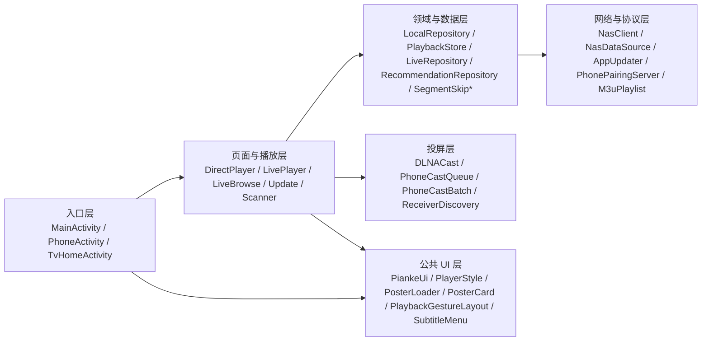
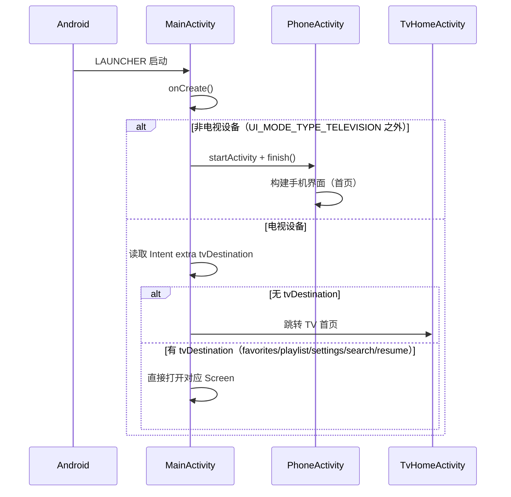
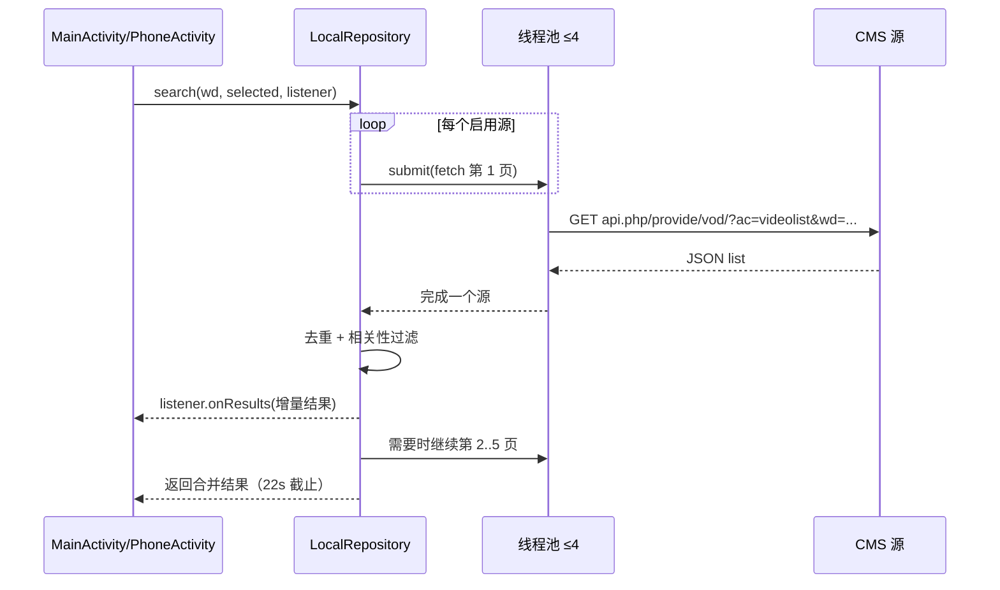

# 01 · 整体架构

本文说明项目的分层结构、双端入口、导航模型、异步与并发模型、核心数据流，以及若干关键设计决策。

---

## 1. 架构目标与约束

| 目标 | 实现方式 |
| --- | --- |
| 单个 APK 同时服务 TV 与手机 | `MainActivity` 通过 `UiModeManager` 判断设备类型，非电视直接转入 `PhoneActivity` |
| 无服务端、可离线保存配置 | 所有数据落在 `SharedPreferences`；内容通过用户导入的 HTTP(S) CMS 接口获取 |
| 播放器与内容协议解耦 | 内容访问统一走 `NasClient` 门面；播放取流统一走 `NasDataSource` |
| 外部输入不可信 | 源地址/二维码/订阅/更新清单均做格式与安全校验，限制大小与重定向 |
| 弱网与直播不稳定可恢复 | 直播采用“有界恢复预算 + 看门狗 + 线路冷却切换”，不做无限重试 |
| 旧版 NAS 形态保留兼容 | `NasClient(URI)` 仍支持 NAS 模式（登录、`/api/proxy` 播放代理） |

---

## 2. 分层架构



| 层 | 职责 | 不应包含 |
| --- | --- | --- |
| 入口层 | 设备分流、页面导航、生命周期、播放器装配 | 具体网络协议解析 |
| 页面与播放层 | 单页交互、列表渲染、播放控制、页面级状态 | 跨页持久化细节 |
| 领域与数据层 | 源管理、搜索、详情、收藏、进度、直播线路、推荐、跳过策略 | View 引用 |
| 网络与协议层 | HTTP 访问、数据源适配、更新校验、局域网服务、文件解析 | UI 布局 |
| 投屏层 | SSDP 发现、SOAP 控制、投屏队列 | 播放器渲染 |
| 公共 UI 层 | 统一视觉、焦点态、海报加载、手势、字幕菜单 | 业务数据 |

---

## 3. 启动与双端分流



### 3.1 导航模型

- **TV**：`MainActivity` 内部用 `Screen` 枚举表示页面：`CONFIG`、`LOGIN`、`SEARCH`、`FAVORITES`、`PLAYLIST`、`SETTINGS`、`PAIRING`、`DETAIL`、`PLAYER`。页面切换由 `showScreen(...)` 驱动，同一 Activity 内替换内容视图。
- **手机**：`PhoneActivity` 用字符串页面名 + `screen(name, heading)` 统一导航，包含 `home`、`search-landing`、`search`、`detail`、`settings`、`config`、`live-sources`、`live`、`history`、`playlist`、`favorites`、`recommendations`、`controls`、`batch` 等。
- **TV 首页**：`TvHomeActivity` 只做推荐/继续观看的入口聚合，点击后携带 `tvDestination` 回到 `MainActivity`。

> `MainActivity` 中的 `LOGIN` 页面在单机模式下实际是“视频来源配置”页，不再是 NAS 登录页。

### 3.2 生命周期要点

- `MainActivity.onStop()` 释放播放器与 `PosterLoader`。
- `DirectPlayerActivity.onStop()` 停止播放并写入进度。
- `LivePlayerActivity` 在 `onStop()` 停止看门狗与重试计时器。
- `PhoneActivity.onDestroy()` 调用 `DLNACast.cleanup()`，避免投屏协程与组播锁泄漏。
- `SourceScannerActivity.onPause()` 立即释放相机。

---

## 4. 单机模式与 NAS 命名的关系

`NasClient` 是内容访问的唯一门面，有两种构造方式：

```java
// 单机模式：origin 为占位域名，全部请求交给 LocalRepository
NasClient client = new NasClient(context);
// => origin = https://standalone.invalid/
// => local  = new LocalRepository(context)

// NAS 模式：真实 HTTP 服务端（旧形态/兼容）
NasClient client = new NasClient(uri);
// => local = null，走 Cookie 会话 + /api/* + /api/proxy
```

`NasClient.request(path, body)` 在单机模式下把 `/api/sources`、`/api/search`、`/api/detail`、`/api/favorites` 等路由分发给 `LocalRepository`；NAS 模式下才发起真实 HTTP 请求。

因此：

- 单机模式**不需要** `NasAddress`、`CredentialStore`、NAS 代理；这些类只服务于可选的 NAS 模式与旧版更新入口。
- `NasDataSource` 在单机模式下允许任意 `http(s)` 媒体地址；在 NAS 模式下只允许同源 `/api/proxy` 路径。

---

## 5. 异步与并发模型

| 执行器 | 位置 | 用途 |
| --- | --- | --- |
| `network`（单线程） | `MainActivity` | 源配置、详情、收藏等串行网络任务 |
| `updateChecks`（单线程） | `MainActivity` | 更新检查，避免与页面任务互相阻塞 |
| `searches`（单线程） | `MainActivity` | 搜索任务排队，保证同一时刻只有一个搜索在跑 |
| `Dispatchers.IO` + 协程 | `PhoneActivity`、投屏 | 手机端用 `lifecycleScope`/自定义 Scope 执行 `work(hint) { ... }` |
| 固定线程池（≤4） | `LocalRepository.search` | 多源并发请求，`CompletionService` 汇总 |
| 2 线程 + 有界队列(64) | `PosterLoader` | 海报下载与解码，`DiscardOldestPolicy` 防止积压 |

### 5.1 过期回调防护（generation 票号）

`MainActivity` 的 `task(hint, work, done)` 在提交任务时分配自增 `generation`；回调回到主线程前比对当前票号，不一致则丢弃。这样快速切换页面/重复搜索时，旧结果不会覆盖新页面。

`PhoneActivity` 使用协程 `Job` 取消 + 页面态校验达到同样效果。

### 5.2 搜索并发与截止时间

`LocalRepository.search(...)`：

1. 只对启用且非成人源并发请求，线程数上限 4；
2. 使用 `CompletionService` 按完成顺序增量回调（`SearchListener`），界面先出结果；
3. 总截止时间 22 秒；
4. 每个源逐页请求，最多 5 页；
5. 结果按 `vod_id + 源 key` 去重，并按名称归一化做相关性过滤。



---

## 6. 核心数据流

### 6.1 搜索 → 详情 → 播放（TV）


### 6.2 直播

```
LiveBrowseActivity / PhoneActivity('live')
  → LiveRepository.channels()（读取各订阅缓存）
  → 选择频道 → LivePlayerActivity
  → preferredLine() 选线路 → ExoPlayer(HLS)
  → LivePlaybackWatchdog 采样
  → 异常 → LiveRecoveryPolicy.fail() → EDGE/RELOAD/SWITCH/STOP
```

### 6.3 收藏与片单

- 收藏：`LocalRepository.favorites(route, body, method)`，`route` 为 `GET/POST/DELETE`，ID 由 `SHA-256(url + ":" + vodId)` 前 16 位生成。
- 片单/历史：`PlaybackStore`，同一 `identity` 在历史和片单中共享进度。

---

## 7. 关键设计决策

| 决策 | 原因 | 影响 |
| --- | --- | --- |
| 保留 `NasClient` 作为门面 | 兼容旧 NAS 形态，避免大范围改播放/数据调用点 | 单机模式需注意 `local != null` 分支 |
| 数据全部用 SharedPreferences | 无数据库依赖、易备份/迁移、数据量有上限 | 需要严格的容量裁剪与 key 规范 |
| 播放统一走 `NasDataSource` | 便于统一处理 Range、200 回退、EOF 校验与访问控制 | `@UnstableApi` 依赖 Media3 内部 API |
| 直播恢复“有界预算” | 防止弱网下无限重试耗电/卡死 | 预算耗尽后停止并提示用户手动重试 |
| 搜索按完成顺序增量回调 | 多源速度差异大，先到先展示 | 需要 UI 侧去重与票号防过期 |
| 更新强制签名一致 | 防止代理/镜像投毒 | 所有通道共用同一校验函数 |
| 手机 UI 纯代码构建 | 避免大量 XML 与 TV/手机布局分叉 | `PhoneActivity` 体量较大（约 1200 行） |

---

## 8. 线程与状态边界

- **UI 状态**只存在于 Activity 字段与当前视图树；页面切换重建视图。
- **持久状态**只通过 `*Store` / `*Repository` 写入 SharedPreferences，不跨页共享内存对象。
- **播放器状态**由 Media3 `Player` 持有；Activity 只保存 `Player` 引用与监听器。
- **投屏状态**由 `DLNACast` 单例引擎（`CoreManager`）持有，`init/cleanup` 显式管理生命周期。

下一篇：[02-modules.md](02-modules.md) 给出逐文件职责清单。
