# 02 · 模块职责与依赖

项目只有一个应用模块 `:app`，业务代码集中在 `app/src/main/java/family/libretv/tv/`（无子包，按文件名表达职责），另有本地库模块 `:upnpcast`。

---

## 1. 模块总览

| 模块 | 文件/目录 | 职责 |
| --- | --- | --- |
| `:app` | `app/` | Android 应用：入口、界面、播放、数据、网络、更新、投屏集成 |
| `:upnpcast` | `third-party/upnpcast/` | 独立 DLNA 投屏库（MIT），通过 `com.yinnho.upnpcast.DLNACast` 暴露 API |

`settings.gradle`：

```groovy
include ':app'
include ':upnpcast'
project(':upnpcast').projectDir = new File(rootDir, 'third-party/upnpcast')
```

---

## 2. 应用内模块分组

### 2.1 入口层

| 文件 | 职责 | 关键依赖 |
| --- | --- | --- |
| `MainActivity.java` | TV 入口与页面调度器；搜索/详情/收藏/片单/设置/配对/播放；遥控按键处理；更新检查；`task()` 异步封装 | `NasClient`、`LocalRepository`、`NasDataSource`、`SegmentSkipController`、`AppUpdater`、`PhonePairingServer` |
| `PhoneActivity.kt` | 手机主界面（纯代码视图）；首页、搜索、详情、历史、片单、收藏、推荐、设置、来源配置、直播源、投屏控制、批量投屏 | `LocalRepository`、`PlaybackStore`、`LiveRepository`、`RecommendationRepository`、`DLNACast` |
| `TvHomeActivity.java` | TV 首页：继续观看、推荐分类、快捷入口；焦点链 `wireHomeFocus` | `LocalRepository`、`PlaybackStore`、`RecommendationRepository` |

### 2.2 页面与播放

| 文件 | 职责 | 关键依赖 |
| --- | --- | --- |
| `DirectPlayerActivity.java` | 手机点播播放器：竖屏详情+选集、横屏全屏、手势、字幕、片头片尾、续播、自动下一集 | Media3、`PlaybackGestureLayout`、`SubtitleMenu`、`SegmentSkipController`、`PlaybackStore` |
| `LivePlayerActivity.java` | 直播播放：错误分类、有界恢复、看门狗、隐藏控制时左右切台、频道分类面板 | Media3 HLS、`LiveRepository`、`LiveRecoveryPolicy`、`LivePlaybackWatchdog` |
| `LiveBrowseActivity.java` | TV 直播频道网格（2–5 列）、分组侧栏、收藏、M3U 导入、订阅管理、刷新 | `LiveRepository`、`M3uPlaylist`、`LivePlaylistFile` |
| `UpdateActivity.java` | 更新 UI：检查、通道选择、下载进度、安装、恢复待安装包、未知来源授权 | `AppUpdater`、`UpdateInstaller` |
| `LegacyUpdateActivity.java` | 仅旧包名 `family.libretv.tv` 使用的可选 NAS 更新入口 | `NasClient`、`CredentialStore`、`AppUpdater` |
| `SourceScannerActivity.java` | 相机扫码与图片识别；本地解码；结果回传 | `SourceQrDecoder` |

### 2.3 领域与数据

| 文件 | 职责 | 关键依赖 |
| --- | --- | --- |
| `LocalRepository.java` | 单机 CMS 核心：源导入/校验/合并/启停/删除、并发搜索、详情、选集解析、收藏、默认源 | `SharedPreferences("standalone-library")` |
| `PlaybackStore.java` | 历史与片单；进度保存与恢复位置计算；身份键 | `SharedPreferences("standalone-playback")` |
| `LiveRepository.java` | 直播订阅 CRUD、定时刷新、频道编码/去重、收藏、线路健康与冷却、请求头与 MIME 探测 | `SharedPreferences("live-library")`、`M3uPlaylist` |
| `RecommendationRepository.java` | 豆瓣公开接口推荐，6 小时缓存，可开关 | `SharedPreferences("recommendations")` |
| `SegmentSkipPolicy.java` | 片头片尾纯函数规则：标题键、合法性、目标位置、是否在片尾 | 无 |
| `SegmentSkipStore.java` | 按剧名持久化片头/片尾/开关 | `SharedPreferences("segment-skip")` |
| `SegmentSkipController.java` | 播放器监听 + 250ms tick；标记、自动跳过、5 秒可取消倒计时 | `SegmentSkipPolicy`、`SegmentSkipStore` |

### 2.4 网络与协议

| 文件 | 职责 | 关键依赖 |
| --- | --- | --- |
| `NasClient.java` | 内容访问门面：单机模式委托 `LocalRepository`，NAS 模式处理 Cookie 会话、同源校验、`/api/proxy` 播放代理 | `LocalRepository`、`AppUpdater`（哈希/编码工具） |
| `NasDataSource.java` | Media3 `BaseDataSource`：Range 请求、200 忽略 Range 时手动 skip、EOF 校验、访问控制 | `NasClient`、`NasAddress` |
| `AppUpdater.java` | 更新清单获取与通道选择、GitHub/Gitee/代理重定向、下载、大小/SHA-256/APK 校验 | `NasClient`、`PackageManager` |
| `UpdateInstaller.java` | API≥24 用 `ACTION_INSTALL_PACKAGE` + FileProvider；<24 用 `PackageInstaller` 会话 | `FileProvider` |
| `UpdateInstallReceiver.java` | `PackageInstaller` 回调：启动用户确认、失败提示 | — |
| `PhonePairingServer.java` | 局域网一次性表单服务：随机端口 + token、5 分钟有效、单次使用、CSP/Origin 校验 | `SourceImportForm`、`LocalRepository`、`LiveRepository` |
| `M3uPlaylist.java` | M3U 解析：`EXTINF` 属性、`EXTVLCOPT` 头、拒绝 HLS 媒体清单、大小/数量上限 | 无 |
| `LivePlaylistFile.java` | 把文档选择器选中的 M3U 文件导入 `LiveRepository` | `LiveRepository`、`M3uPlaylist` |

### 2.5 投屏

| 文件 | 职责 | 关键依赖 |
| --- | --- | --- |
| `CastUrl.java` | 投屏 URL 白名单：仅 http(s) 公网直链，拒绝 NAS 同源地址 | — |
| `PhoneCastQueue.kt` | 投屏队列数据类：条目、当前集、相邻集、标签 | — |
| `PhoneCastBatch.kt` | 顺序批量投递，间隔 1.2s，失败不重试返回 unconfirmed，可停止 | `DLNACast` |
| `ReceiverDiscovery.kt` | 并发拉取设备 description XML，校验 `AVTransport` 服务；禁 DOCTYPE/ENTITY、限 256KB | `CastUrl` |

### 2.6 公共 UI 与工具

| 文件 | 职责 |
| --- | --- |
| `PiankeUi.java` | 品牌色、圆角面板、焦点态、入口按钮、关于对话框（“留点片刻，看点喜欢的”） |
| `PlayerStyle.java` | 播放器按钮样式、TV 焦点背景、纯 Canvas 矢量图标（播放/暂停/字幕/星标等） |
| `PosterLoader.java` | 有界封面加载：LruCache 8MB、2 线程、64 队列、豆瓣 Referer、最大 5MB/20000px、降采样到 480×720 |
| `PosterCard.java` | TV 海报卡：单一焦点目标、子视图不抢焦点、聚焦缩放 |
| `PlaybackGestureLayout.java` | 手机播放手势层：单击显隐控制、双击 ±5s（点播 ±10s）、横拖进度、左亮右音 |
| `SubtitleMenu.java` | 字幕策略与菜单：自动优先中文、关闭、按语言/轨道覆盖；文本轨道策略跨集保留 |
| `SourceImportForm.java` | 手机端局域网表单 HTML（逐条/文本/订阅三种模式）及前端校验 |
| `PairingQr.java` | 生成配对二维码 Bitmap（ZXing） |
| `SourceQrDecoder.java` | 二维码内容解析与安全校验；`libretv://sources` 压缩负载；相机帧/图片解码 |
| `NasAddress.java` | NAS 地址解析：仅 http(s)、禁止凭据/查询/片段/localhost；同源判断 |
| `CredentialStore.java` | NAS 密码加密存储：AES-GCM + AndroidKeyStore，AAD 绑定 origin |
| `M3uPlaylist.java` | 见 2.4 |

---

## 3. 依赖关系图（文件级）

```mermaid
flowchart TB
  MA[MainActivity] --> NC[NasClient]
  MA --> ND[NasDataSource]
  MA --> LR[LocalRepository]
  MA --> SK[SegmentSkipController]
  MA --> UP[AppUpdater]
  MA --> PP[PhonePairingServer]
  MA --> PL[PosterLoader]
  MA --> PS[PlaybackStore]

  PA[PhoneActivity] --> LR
  PA --> PS
  PA --> LV[LiveRepository]
  PA --> RR[RecommendationRepository]
  PA --> DL[DLNACast]
  PA --> MB[PhoneCastBatch]
  PA --> PQ[PhoneCastQueue]
  PA --> RD[ReceiverDiscovery]
  PA --> SA[SourceScannerActivity]

  TH[TvHomeActivity] --> LR
  TH --> PS
  TH --> RR

  DP[DirectPlayerActivity] --> PS
  DP --> SK
  DP --> SM[SubtitleMenu]
  DP --> PG[PlaybackGestureLayout]

  LP[LivePlayerActivity] --> LV
  LP --> RP[LiveRecoveryPolicy]
  LP --> WD[LivePlaybackWatchdog]

  LB[LiveBrowseActivity] --> LV
  LB --> LP

  NC --> LR
  ND --> NC
  ND --> NA[NasAddress]
  PP --> LR
  PP --> LV
  LV --> M3[M3uPlaylist]
  LF[LivePlaylistFile] --> LV
  LF --> M3
  AU[AppUpdater] --> NC
  UA[UpdateActivity] --> AU
  UA --> UI[UpdateInstaller]
  SA --> SQ[SourceQrDecoder]
  SQ --> LR
```



---

## 4. `upnpcast` 模块结构

```text
third-party/upnpcast/src/main/java/com/yinnho/upnpcast/
├── DLNACast.kt                公共 API（object 单例）
├── CastOptions.kt             投屏选项（metadata / subtitle / mime / upnpClass）
└── internal/
    ├── core/
    │   ├── CoreManager.kt     引擎：发现、控制器缓存、组播锁、投屏入口
    │   ├── UpnpHttp.kt        SOAP/HTTP 底层
    │   └── CacheManager.kt    进度/音量缓存
    ├── discovery/
    │   ├── SsdpDeviceDiscovery.kt  SSDP M-SEARCH 与 NOTIFY
    │   ├── RemoteDevice.kt         设备模型（地址、location、服务列表）
    │   └── DeviceDescriptionParser.kt  description XML 解析
    ├── media/
    │   └── DlnaMediaController.kt  AVTransport/RenderingControl SOAP 控制
    ├── localcast/
    │   ├── LocalCastManager.kt     本地文件投屏
    │   ├── LocalFileServer.kt      临时 HTTP 文件服务
    │   └── VideoScanner.kt         本机视频扫描
    ├── util/
    │   ├── SoapXml.kt / SsdpHeaders.kt / MetadataBuilder.kt
    │   ├── UpnpTime.kt / MimeTypes.kt
    ├── UPnPException.kt
    └── FileUtils.kt
```

### 4.1 公共 API 一览（`DLNACast`）

| API | 说明 |
| --- | --- |
| `init(context)` / `cleanup()` | 创建/销毁引擎；`init` 会先清理旧引擎 |
| `search(timeout)` | SSDP 搜索，返回 `List<Device>` |
| `cast(url, title, options)` | 自动选择最佳设备并投屏 |
| `castToDevice(device, url, title, options)` | 投指定设备 |
| `reconnect(device, expectedUri)` | 不重发 SetURI/Play，仅重新接管控制 |
| `reconnectQueue(device, expectedUris)` | 接收端队列可能已切集，返回匹配的当前 URI |
| `play/pause/stop/seek/setVolume/setMute` | 播放控制 |
| `getProgress()` / `getProgressRealtime()` | 播放进度 |
| `getPlaybackState()` | 从设备 `GetTransportInfo` 读取真实状态 |
| `getVolume()` / `refreshVolumeCache()` | 音量与静音 |
| `getState()` | 连接设备、播放状态、音量快照 |
| `castLocalFile(path, device, title, options)` | 本地文件投屏（需 `init`） |

> 引擎未初始化时，查询类 API 返回中性默认值（空列表/IDLE/false），`castLocalFile` 抛出 `UPnPException.UnknownError`。

下一篇：[03-core-classes.md](03-core-classes.md) 逐个说明关键类与函数。
