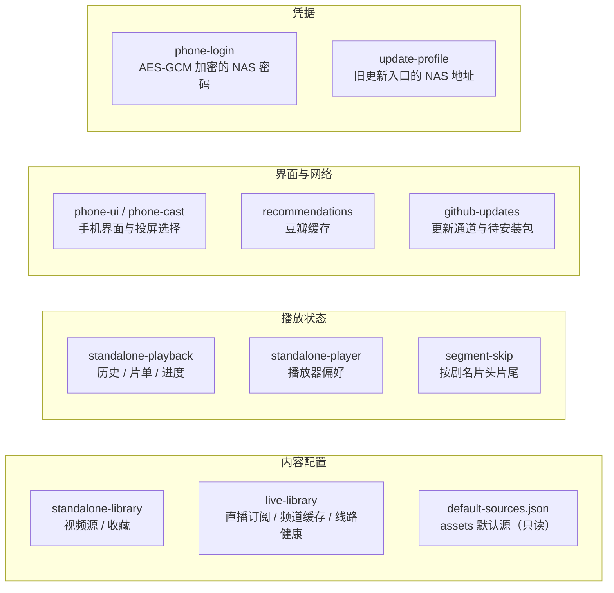

# 04 · 数据存储

项目没有数据库与服务端，所有持久状态都存放在 **SharedPreferences**（XML）。本文汇总各存储文件、键规则、容量上限与安全设计。

---

## 1. 存储全景



---

## 2. SharedPreferences 清单

| 文件 | 写入方 | 主要内容 | 容量/策略 |
| --- | --- | --- | --- |
| `standalone-library` | `LocalRepository` | `sources`（JSON 数组）、`favorites`、`knownDefaultUrls` | 源最多 50；`knownDefaultUrls` 最多 50 |
| `standalone-playback` | `PlaybackStore` | `history`、`playlist` | 历史 50 条；片单 200 条 |
| `standalone-player` | 播放页 | 倍速、字幕模式等播放偏好 | 键值对 |
| `live-library` | `LiveRepository` | `subscriptions`、`cache-<id>`、`updated-<id>`、`url-<id>`、`attempt-<id>`、`error-<id>`、`favorites`、`lastChannel`、`automatic`、`interval`、`seenDefaults` | 单文件 ≤4MB（M3U 限制）；频道 ≤5000/订阅 |
| `recommendations` | `RecommendationRepository` | 各分类缓存 JSON、更新时间、开关 | TTL 6 小时，覆盖旧值 |
| `segment-skip` | `SegmentSkipStore` | `<剧名>:intro`、`:outro`、`:enabled` | 每个剧名 3 个键 |
| `phone-ui` | `PhoneActivity` | 上次页面、布局偏好、投屏设备选择等 | 键值对 |
| `phone-cast` | `PhoneActivity` | 上次投屏设备、队列状态提示 | 键值对 |
| `github-updates` | `UpdateActivity` / `AppUpdater` | 更新通道、上次检查时间、待安装 APK 元数据 | 24 小时检查节流 |
| `update-profile` | `LegacyUpdateActivity` | 旧更新入口的 NAS 地址 | 仅旧包名使用 |
| `phone-login` | `CredentialStore` | `origin`、`iv`、`secret`（密文） | 仅保存 1 份，绑定 origin |
| `MainActivity`（默认文件） | 旧版遗留 | `nas` 等旧键（仅迁移读取） | 只读兼容 |

> `default-sources.json` / `default-live-sources.json` 由 Gradle 任务 `prepareSourceAssets` 在构建时写入 `assets/generated/sourceAssets`，运行时只读；`-PincludeLocalSources=false` 时输出空源。

---

## 3. Key 生成规则

| 场景 | 规则 | 代码位置 |
| --- | --- | --- |
| 视频源 key | `SHA-256(url)` 前 16 位十六进制 | `LocalRepository.key(url)` |
| 收藏 ID | `SHA-256(url + ":" + vodId)` 前 16 位 | `LocalRepository` |
| 播放身份 | `source.url`（去尾部 `/`）+ `"|"` + `vodId` | `PlaybackStore.identity` |
| 直播订阅 ID | `sha256(url)[0..16]`；本地文件为 `file-<hash(name)>` | `LiveRepository` |
| 直播频道 ID | 订阅 ID + 频道序号/名称哈希 | `LiveRepository.encode` |
| 线路健康 | 频道 ID + `:line<i>:fail/:stable` | `LiveRepository` |
| 片头片尾 | `titleKey(剧名)` + `:intro/:outro/:enabled`；`titleKey` 去空白并小写 | `SegmentSkipPolicy.titleKey` |
| 海报缓存 | `(client.origin 或 "public") + "|" + url` | `PosterLoader` |
| 配对令牌 | 24 字节随机数，base64url | `PhonePairingServer` |

使用哈希而非原始 URL 作为键，避免 `/`、`?`、`#` 等字符污染 SharedPreferences 键名，并压缩长度。

---

## 4. 关键数据结构

### 4.1 视频源（`standalone-library.sources`）

```json
[
  {
    "key": "a1b2c3d4e5f60718",
    "name": "示例源",
    "url": "https://example.com/api.php/provide/vod/",
    "enabled": true,
    "addedAt": 1730000000000
  }
]
```

### 4.2 历史/片单记录（`standalone-playback`）

```json
{
  "id": "身份哈希",
  "title": "剧名",
  "poster": "https://...",
  "source": { "name": "示例源", "url": "https://..." },
  "item": { "vod_id": 123, "vod_name": "剧名" },
  "index": 2,
  "position": 123456,
  "duration": 2400000,
  "updatedAt": 1730000000000
}
```

`save(...)` 只写入白名单字段（`cleanItem`），防止把整段接口响应持久化。

### 4.3 直播频道（`live-library.cache-<id>`）

```json
[
  {
    "id": "频道哈希",
    "name": "频道名",
    "group": "央视",
    "logo": "https://...",
    "lines": [
      { "url": "https://.../index.m3u8", "userAgent": "...", "referer": "..." }
    ]
  }
]
```

同一 `tvg-id`（无则名称）的多条 `EXTINF` 会合并为同一频道的多条 `lines`。

### 4.4 更新元数据

`github-updates` 保存：

- 当前通道：`auto | github | gitee | proxy | custom`；
- 上次检查时间（24 小时节流）；
- 待安装 APK：文件名、大小、SHA-256、versionCode；
- 自定义代理前缀。

---

## 5. 容量与清理策略

| 数据 | 上限 | 超限行为 |
| --- | --- | --- |
| 视频源 | 50 | 导入时拒绝并提示 |
| 已删除默认源记录 | 50 | 先进先出裁剪 |
| 历史 | 50 | 移除最旧 |
| 片单 | 200 | 拒绝新增或移除最旧（以实现为准） |
| 直播订阅 | 单文件 128KB 请求体 / M3U 4MB | 超限拒绝 |
| 直播频道 | 5000/订阅 | 解析时截断 |
| 推荐缓存 | 6 小时 TTL | 过期后刷新，失败保留旧值 |
| 海报内存缓存 | 8MB LRU | 自动淘汰 |
| 更新 APK | 100MB | 超过拒绝下载 |

`PlaybackStore.resumePosition` 的“看完”判定：当 `duration - position <= min(15s, duration/20)` 时归零，避免下次从片尾几秒处继续。

---

## 6. 安全设计

| 项 | 措施 |
| --- | --- |
| 凭据存储 | `CredentialStore` 使用 AndroidKeyStore 中的 AES 密钥 + GCM；AAD 绑定 NAS origin；只保留一份配置；`allowBackup=false` 防止备份导出 |
| 明文密码 | 输入框 `setSaveEnabled(false)`；保存后立即清空 |
| 源地址 | `LocalRepository.validate` 仅允许 http(s)，拒绝 userinfo 与 fragment |
| 二维码内容 | `SourceQrDecoder.payload` 先校验再导入；解压上限 100KB；压缩分享上限 1600 字符 |
| 局域网表单 | 随机 token、5 分钟过期、单次使用、Origin/Host 校验、CSP、请求体 128KB 上限 |
| 更新下载 | 大小、SHA-256、包名、versionCode、签名一致；重定向限 host 与次数 |
| 播放代理 | NAS 模式仅允许同源 `/api/proxy`；单机模式允许任意 http(s) 但仅用于媒体 |
| 投屏地址 | `CastUrl` 仅允许公网 http(s)，拒绝 NAS 同源（避免把内网凭据暴露给接收端） |
| 设备描述解析 | `ReceiverDiscovery` 禁 DOCTYPE/ENTITY，限 256KB，防 XXE 与内存膨胀 |

> 项目中不存在硬编码的真实影视源、直播源或凭据；`BuildConfig.DEFAULT_NAS_URL/DEFAULT_NAS_PASSWORD` 默认为空串。

---

## 7. 迁移与兼容

- `LocalRepository.mergeDefaults` 在每次启动时把打包默认源合并进用户列表；用户删除过的默认源记录在 `knownDefaultUrls`，不会被再次添加。
- `NasClient(Context)` 让旧的 `/api/*` 调用点无需修改即可在单机模式工作。
- `LegacyUpdateActivity` 仅在 `applicationId == family.libretv.tv`（`-PfamilyUpgrade=true` 构建）时启用，并会从多个旧 SharedPreferences 读取 NAS 地址作为迁移来源。
- 旧版 NAS 用户仍可用 `NasClient(URI)` 模式；单机数据与 NAS 数据互不覆盖（不同的存储文件与路由）。

下一篇：[05-playback.md](05-playback.md)。
