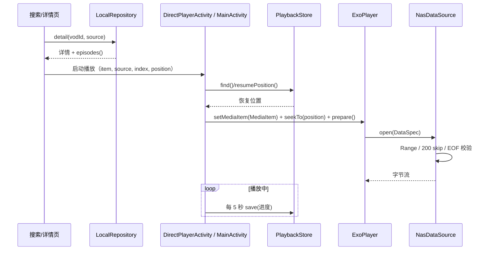
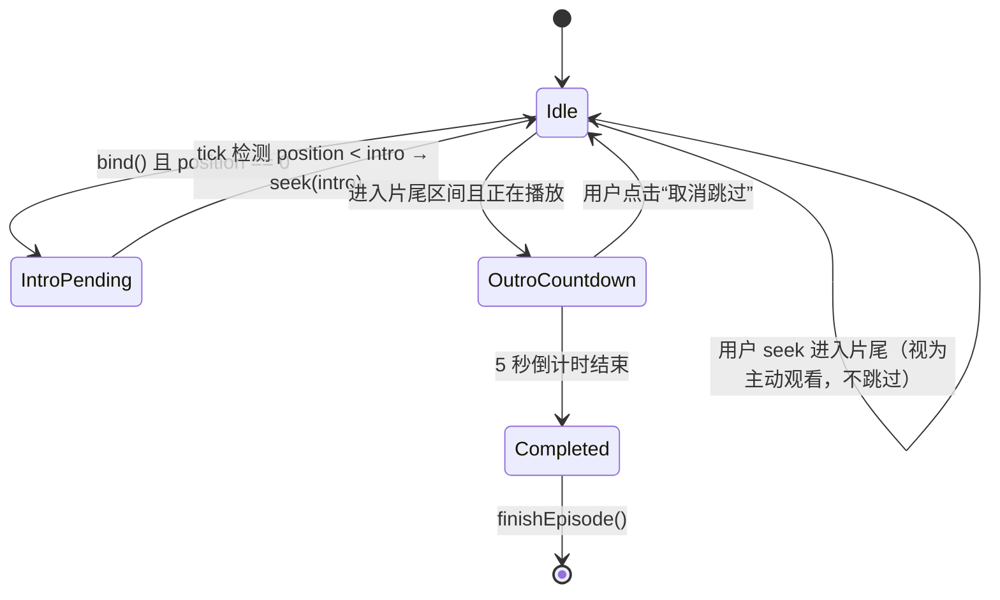
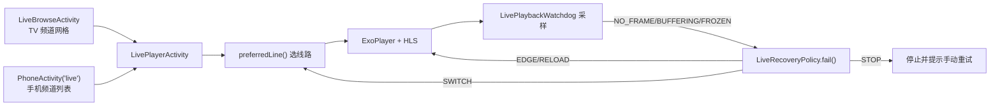
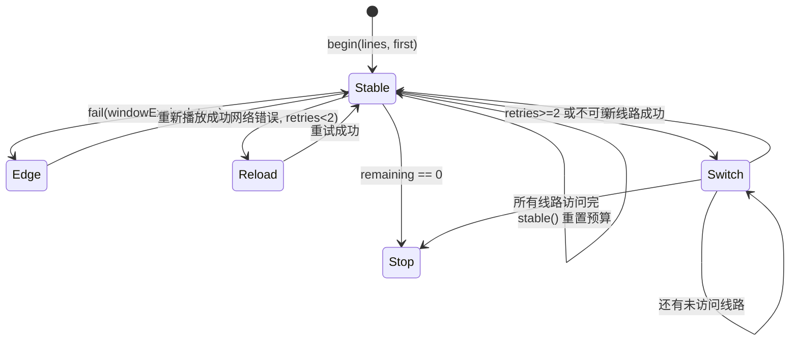

# 05 · 播放链路

播放分为两条独立链路：**点播（VOD）** 与 **直播（Live）**。二者都基于 Media3/ExoPlayer，但数据源、错误处理与恢复策略不同。

---

## 1. 点播链路

### 1.1 总体流程



### 1.2 播放器装配

TV（`MainActivity.showPlayer`）与手机（`DirectPlayerActivity`）使用同一模式：

```java
player = new ExoPlayer.Builder(context)
    .setMediaSourceFactory(new DefaultMediaSourceFactory(() -> new NasDataSource(client)))
    .build();
```

`NasDataSource` 统一承担：

- 访问控制（单机允许任意 http(s)；NAS 仅 `/api/proxy`）；
- `Range` 请求；
- 上游忽略 Range 返回 200 时，手动 `skip(position)`，避免 MP4 seek 数据错位；
- 提前 EOF 抛异常而不是静默结束；
- `transferInitializing/Started/Ended` 传输回调，供播放器统计。

### 1.3 选集与自动下一集

1. `LocalRepository.episodes(playUrl)` 解析 `vod_play_url`：
   - 先按 `$$$` 分组（不同播放源/线路）；
   - 组内按 `#` 分集；
   - 每集格式 `名称$地址`；
   - 优先选择包含 `m3u8` 的分组。
2. 播放页渲染选集网格，点击切换。
3. 一集结束后：
   - `DirectPlayerActivity` 若存在下一集则自动播放；
   - TV 侧由 `SegmentSkipController` 的 `finishEpisode` 回调驱动下一集或返回详情。

### 1.4 续播规则

`PlaybackStore.save(...)` 每 5 秒写入一次（`DirectPlayerActivity.onStop` 也会写）。恢复时：

```java
long position = PlaybackStore.resumePosition(savedPosition, duration);
// duration - position <= min(15s, duration/20) 时返回 0
```

即“距结尾很近”视为已看完，从头开始。

### 1.5 片头片尾

三者职责分离：

| 类 | 职责 |
| --- | --- |
| `SegmentSkipPolicy` | 纯函数：合法性、目标位置、是否进入片尾 |
| `SegmentSkipStore` | 按剧名持久化 |
| `SegmentSkipController` | 与播放器交互：标记、自动跳过、倒计时 UI |

状态机：



要点：

- 片头只在“本集从 0 开始”时自动跳一次（`introPending`）。
- 用户手动 seek 到片尾区间时，`ignoreOutro=true`，不触发跳过。
- 倒计时 5 秒，期间可取消；取消后本集不再自动跳过片尾。
- `mark(tail)` 校验：片头片尾不重叠，且正片至少 1 秒。
- 标记片尾时保存的是 `duration - position`（片尾长度），而不是绝对位置。

### 1.6 手机手势

`PlaybackGestureLayout` 仅对触摸设备生效，排除：

- TV（`UI_MODE_TYPE_TELEVISION`）；
- 开启无障碍触摸探索；
- 鼠标输入；
- 按钮、`SeekBar`、`TimeBar` 等控件区域。

| 手势 | 行为 |
| --- | --- |
| 单击 | 显示/隐藏控制栏 |
| 双击左/右 1/3 | 后退/前进 5 秒（点播 10 秒） |
| 横向拖动 | 预览并跳转进度（最大跨度 120 秒） |
| 左侧竖滑 | 屏幕亮度（2%–100%） |
| 右侧竖滑 | 媒体音量 |

### 1.7 字幕

`SubtitleMenu`：

- 持久化 `subtitleMode`：`auto`（优先 `zh/zh-Hans/zh-Hant/en`）、`off`、`lang:<tag>`。
- 通过 `TrackSelectionParameters` 设置首选语言、禁用文本轨道、清除文本覆盖。
- 关闭时立即隐藏 `SubtitleView` 并清空 cues，避免残留字幕。
- 内嵌 CEA608/708 会标注“可能为空轨”；不支持的格式标注“当前格式不支持”。

### 1.8 TV 遥控

`MainActivity.dispatchKeyEvent`：

- 播放页左右键：快退/快进 30 秒；
- 长按：60 秒；
- 返回：先收起控制栏，再退出播放页。

---

## 2. 直播链路

### 2.1 总体流程



### 2.2 播放器参数

```java
DefaultLoadControl load = new DefaultLoadControl.Builder()
    .setBufferDurationsMs(10_000, 25_000, 1_500, 4_000).build();

DefaultHttpDataSource.Factory http = new DefaultHttpDataSource.Factory()
    .setUserAgent(...)                 // 线路 UA，缺省用 LocalRepository.UA
    .setConnectTimeoutMs(8_000)
    .setReadTimeoutMs(12_000)
    .setAllowCrossProtocolRedirects(true)
    .setDefaultRequestProperties(LiveRepository.headers(line)); // UA / Referer

DefaultMediaSourceFactory factory = new DefaultMediaSourceFactory(http)
    .setLoadErrorHandlingPolicy(new DefaultLoadErrorHandlingPolicy(1))
    .setLiveTargetOffsetMs(5_000);
```

`setLiveTargetOffsetMs(5000)` 让播放器保持在直播边缘后 5 秒，兼顾低延迟与抗抖动。

### 2.3 错误分类

`classify(Throwable)` 将异常归入：

| 类别 | 触发 | 处理 |
| --- | --- | --- |
| 落后直播窗口（BEHIND_LIVE_WINDOW） | 播放位置落后于 HLS 窗口 | 直接回到直播边缘（EDGE），延迟 0/1s |
| 解码错误 | 解码器初始化/渲染失败 | 不可重试，直接切换线路 |
| HTTP 状态错误 | 4xx/5xx | 视状态决定重载或切线路 |
| 超时 / DNS / SSL | 网络层异常 | RELOAD（2s/6s）后切线路 |

### 2.4 有界恢复：`LiveRecoveryPolicy`



| 常量 | 值 | 说明 |
| --- | --- | --- |
| `MAX_RECOVERIES` | 5 | 每个“轮次”的总恢复预算 |
| 同线路重试 | `retries < 2` | 前两次重试不换线路 |
| EDGE 延迟 | 0ms / 1000ms | 落后直播窗口时优先回边缘 |
| RELOAD 延迟 | 2000ms / 6000ms | 网络错误的退避 |
| SWITCH 延迟 | 500ms | 换线路等待 |

`begin(...)` 开启新轮次；用户手动切台/重试等同“显式开始新一轮”，重置预算。暂停或用户抑制期间不消耗预算。

### 2.5 看门狗：`LivePlaybackWatchdog`

基于单调时钟，不依赖 Android API：

| 阈值 | 值 | 信号 |
| --- | --- | --- |
| `FIRST_FRAME_MS` | 30s | `NO_FRAME`：始终没有首帧 |
| `BUFFERING_MS` | 20s | `BUFFERING`：首帧后持续缓冲 |
| `FROZEN_MS` | 15s | `FROZEN`：已就绪但位置不前进 |
| `STABLE_MS` | 30s | `STABLE`：稳定播放，可用于清除失败标记 |

`sample(now, shouldPlay, buffering, ready, frameAvailable, newPosition)` 每次返回一个 `Signal`；`shouldPlay=false`（暂停/后台）时重置计时并返回 `NONE`，不消耗恢复预算。

### 2.6 线路健康与切换

`LiveRepository`：

- `preferredLine(channel, now)`：跳过处于 10 分钟冷却期的线路，优先上次稳定线路；
- `markLineFailed(...)`：记录失败时间，进入冷却；
- `markLineStable(...)`：记录稳定，清除失败状态。

线路请求头来自 M3U 的 `EXTVLCOPT:http-user-agent` / `http-referer`，通过 `headers(line)` 注入所有请求。

### 2.7 交互

- 控制栏隐藏时，TV 左右键直接切换频道（不显示 UI）。
- 手机返回键：先关闭选台覆盖层，再返回频道列表；不先隐藏控制栏。
- 频道分类面板按 `group-title` 分组。

---

## 3. M3U 解析

`M3uPlaylist.parse(String)`：

| 限制 | 值 |
| --- | --- |
| 最大字节 | 4MB |
| 最大频道数 | 5000 |
| 单行最大长度 | 16384 |

解析规则：

- 去除 BOM 与首尾空白；
- 识别 `#EXTM3U` 头；
- `#EXTINF:-1 tvg-id="..." tvg-logo="..." group-title="...",频道名`；
- `#EXTVLCOPT:http-user-agent=...` / `http-referer=...`；
- `tvg-logo` 必须是 http(s)，否则丢弃；
- 若内容本身是 HLS 媒体清单（含 `#EXT-X-`）则拒绝，提示使用订阅地址。

---

## 4. 播放相关存储键

| 键 | 文件 | 用途 |
| --- | --- | --- |
| `history` / `playlist` | `standalone-playback` | 历史与片单 |
| `subtitleMode` | `standalone-player` | 字幕策略 |
| `speed` | `standalone-player` | 播放倍速 |
| `<剧名>:intro/:outro/:enabled` | `segment-skip` | 片头片尾 |
| `lastChannel` | `live-library` | 上次直播频道 |
| `favorites` | `live-library` | 直播收藏 |

下一篇：[06-casting.md](06-casting.md)。
