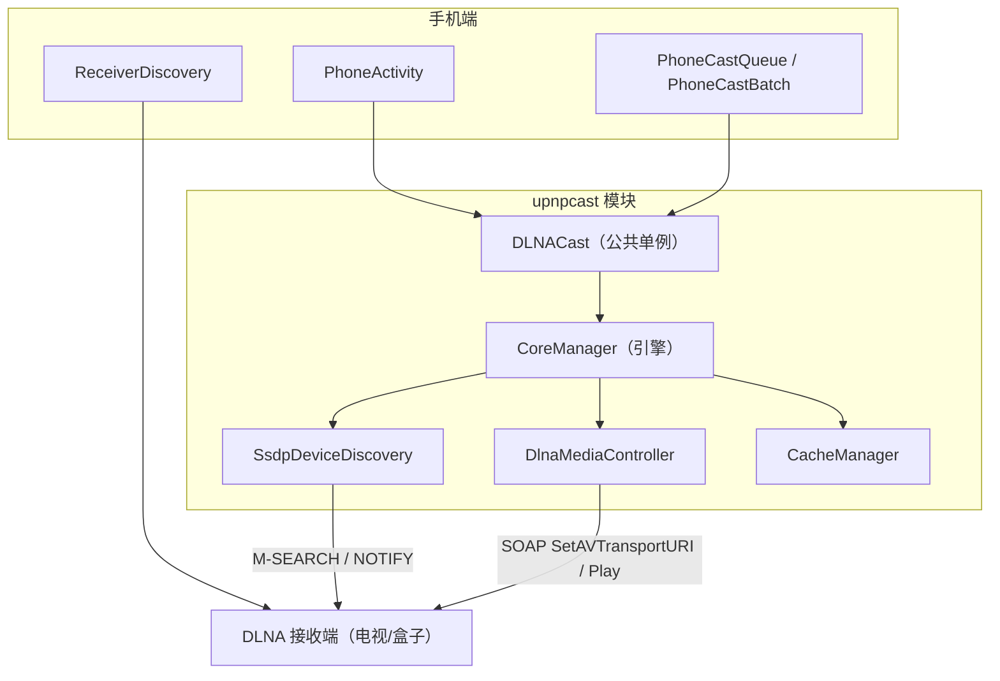
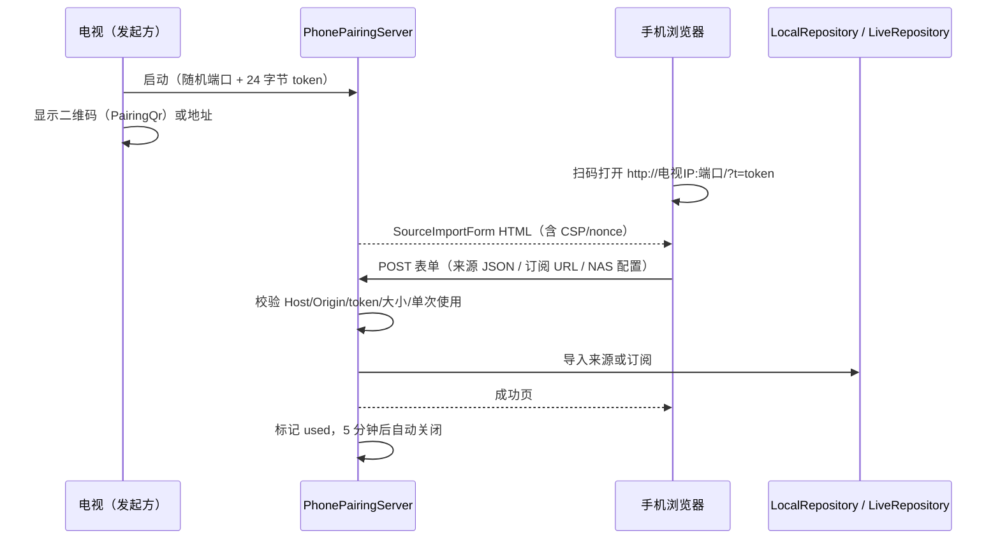

# 06 · 投屏与局域网导入

投屏能力分两部分：

1. **DLNA 投屏**：内置 `:upnpcast` 模块，负责 SSDP 发现与 SOAP 控制；
2. **局域网配对**：手机把来源配置发送到电视（`PhonePairingServer` + 二维码）。

---

## 1. 投屏架构



### 1.1 初始化与销毁

```kotlin
DLNACast.init(applicationContext)   // 创建 CoreManager，获取 Wi-Fi 组播锁
// ... 使用 ...
DLNACast.cleanup()                  // 关闭协程作用域、释放组播锁
```

`PhoneActivity.onDestroy()` 调用 `cleanup()`，避免引擎与组播锁泄漏。`init` 会先 `cleanup` 旧引擎，因此重复初始化不会残留静态状态。

### 1.2 设备发现

- `DLNACast.search(timeout)`：调用 `SsdpDeviceDiscovery.startSearch()`，等待完整 `timeout`（默认 5 秒）后返回全部设备，不因首个设备出现而提前结束。
- `CoreManager` 持有 `WifiManager.MulticastLock`，否则 Android 默认过滤组播，SSDP 响应会丢失。
- 设备模型 `DLNACast.Device(id, name, address, isTV)`。

### 1.3 投屏与控制

| 操作 | API | 说明 |
| --- | --- | --- |
| 投屏到指定设备 | `castToDevice(device, url, title, options)` | `SetAVTransportURI` + `Play` |
| 自动选择设备 | `cast(url, title, options)` | 无设备时先搜索 3 秒，再选最佳设备 |
| 播放控制 | `play/pause/stop/seek/setVolume/setMute` | SOAP 调用 |
| 状态查询 | `getPlaybackState()` | 从设备 `GetTransportInfo` 读取真实状态 |
| 进度 | `getProgress()` / `getProgressRealtime()` | 走 `CacheManager`，后者强制刷新 |
| 音量 | `getVolume()` / `refreshVolumeCache()` | 返回音量与静音状态 |
| 接管现有会话 | `reconnect(device, expectedUri)` | 不重发 SetURI/Play |
| 队列接管 | `reconnectQueue(device, expectedUris)` | 接收端可能已自动切集，返回匹配的当前 URI |

`CastOptions` 可覆盖 DIDL-Lite 元数据、字幕 URL/MIME、媒体 MIME、UPnP class。

### 1.4 手机端投屏队列

`PhoneCastQueue`（data class）：

```kotlin
data class PhoneCastQueue(
    val title: String,
    val urls: List<String>,
    val index: Int,
    val poster: String?,
    val itemJson: String,
    val sourceJson: String
)
```

- `at(i)`：取第 i 集；
- `adjacent(delta)`：上一集/下一集；
- `label()`：用于 UI 显示的“剧名 · 第 N 集”。

`PhoneCastBatch`：

- 按队列顺序逐集投递；
- 每集间隔 **1.2 秒**，避免接收端来不及切换；
- 单集失败**不重试**，标记为 `unconfirmed` 并继续/停止（由调用方决定）；
- `stop()` 可中断后续投递。

### 1.5 重连

手机切后台再回来时，不重新发起投屏，而是：

1. `reconnectQueue(device, expectedUris)` 查询接收端当前 URI；
2. 若命中预期集合，则接管控制与进度；
3. 否则提示用户重新投屏。

### 1.6 地址安全：`CastUrl`

只有满足以下条件的 URL 才允许投屏：

- scheme 为 `http` 或 `https`；
- 不是 NAS 同源地址（`NasAddress.sameOrigin` 为 false）。

原因：NAS 地址可能携带内网凭据或只能内网访问，投给第三方接收端既不可达也可能泄露信息。单机模式下内容多为公网 CMS 直链，可正常投屏。

### 1.7 接收端能力校验：`ReceiverDiscovery`

- 并发（信号量 6）拉取设备 description XML；
- 只接受包含 `AVTransport` 服务的设备；
- 禁止 `DOCTYPE` / `ENTITY`，防 XXE；
- 单文件上限 256KB。

用于在设备列表中过滤掉只支持发现、不支持播放控制的设备。

---

## 2. 局域网配对导入

### 2.1 使用流程



### 2.2 服务端约束

`PhonePairingServer`：

| 项 | 值/策略 |
| --- | --- |
| 监听 | `ServerSocket` 随机端口，仅局域网可达 |
| 令牌 | 24 字节随机数；URL 携带 |
| 有效期 | 5 分钟 |
| 使用次数 | 1 次（`AtomicBoolean` CAS） |
| 请求体 | ≤128KB |
| 校验 | `Host` 与 `Origin` 必须匹配本机；防 DNS rebinding |
| 响应头 | CSP 限制脚本来源，仅允许 nonce 内联脚本 |
| 模式 | 视频来源 JSON、直播订阅 URL、NAS 地址+密码 |

### 2.3 表单页面：`SourceImportForm`

纯内联 HTML/CSS/JS，三种录入方式：

1. **逐条填写**：名称 + 接口地址，可连续“追加一条”（上限 50），最后统一发送；
2. **导入文本**：粘贴来源 JSON（支持 `sources` 对象、数组、TVBox `sites`、单对象）；
3. **订阅地址**：只提交一个 JSON 订阅 URL。

前端校验：

- 必须是完整 http(s) 地址；
- 不允许用户名/密码/`#` 片段；
- JSON 必须可解析；
- 编码后长度 + 7 ≤ 131072 字节。

### 2.4 二维码

| 类 | 用途 |
| --- | --- |
| `PairingQr.create(url, size)` | 生成配对链接二维码（ZXing，容错 M） |
| `SourceQrDecoder.bitmap(bmp)` | 从图片识别 |
| `SourceQrDecoder.preview(yuv, w, h)` | 从相机 NV21 帧识别 |
| `SourceQrDecoder.payload(raw)` | 解析并校验内容 |
| `SourceQrDecoder.sharePayload(json)` | 生成可分享的 `libretv://sources` 负载 |

`libretv://sources` 支持三种参数：

- `?config=<JSON>`：直接内联配置；
- `?url=<订阅地址>`：订阅；
- `?z=<base64url(deflate(json))>`：压缩配置（原始 JSON > 1200 字节时使用）。

限制：压缩后分享串 ≤1600 字符；解析后配置 ≤100KB；非 `libretv://` 内容必须是 http(s) 订阅或合法 JSON。

### 2.5 扫码页

`SourceScannerActivity`：

- 仅此页申请 `CAMERA` 权限；
- 优先后置相机，预览宽度 640–1280；
- 连续对焦（若支持）；
- 解码在单线程执行器，`AtomicBoolean` 防止并发解码；
- 支持“从二维码图片识别”（`ACTION_OPEN_DOCUMENT`，限 12MB，降采样到 ≤1800px）；
- 识别成功后 `setResult(RESULT_OK, sourceConfig)` 返回上一页，由上一页决定导入。

相机帧与图片**不落盘、不上传**，解码全部在本地完成。

---

## 3. 投屏相关 UI 状态

| 存储 | 键 | 用途 |
| --- | --- | --- |
| `phone-cast` | 上次设备 ID/名称 | 下次打开投屏页默认选中 |
| `phone-cast` | 队列提示状态 | 恢复“正在投屏”提示 |
| `phone-ui` | 布局偏好 | 横竖屏页面状态 |

投屏控制页每 **3 秒**轮询一次进度与音量；页面离开即停止轮询，避免后台耗电。

下一篇：[07-update.md](07-update.md)。
