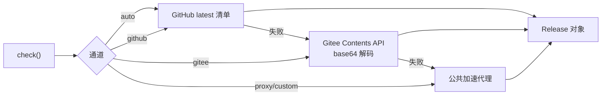
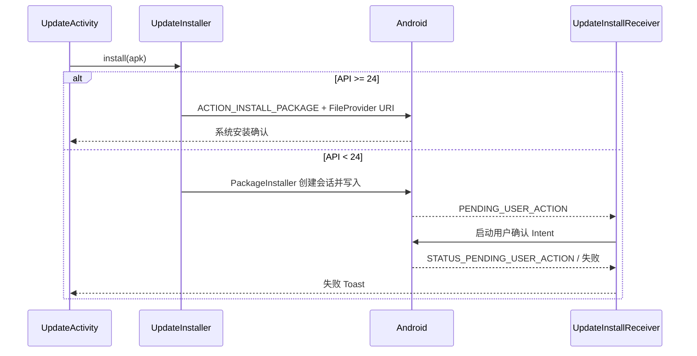

# 07 · 应用更新

本项目不依赖应用商店，采用 **GitHub Releases + Gitee 镜像 + 公共 HTTPS 加速** 的自更新方案。所有通道共用同一套校验逻辑，任何通道都不能绕过。

---

## 1. 通道策略

| 模式 | 值 | 行为 |
| --- | --- | --- |
| 自动（默认） | `auto` | 依次尝试：GitHub 直连 → Gitee 下载镜像 → 公共加速代理 |
| 仅 GitHub | `github` | 只走 GitHub Releases |
| 仅 Gitee | `gitee` | 只走 Gitee Contents API / 下载分支 |
| 仅加速 | `proxy` | 通过 `ghfast.top` / `gh-proxy.org` 访问 GitHub 资源 |
| 自定义 | `custom` | 用户填写加速前缀，需通过 `validateProxy` 校验 |

一旦成功获取清单，本次下载优先沿用同一通道，避免中途切换导致校验失败。

---

## 2. 更新清单

GitHub Release 附件名为 `update-family.libretv.standalone.json`；Gitee 通过 Contents API 读取同一内容（`encoding=base64`，解码后校验）。

`AppUpdater.Release` 字段：

| 字段 | 校验点 |
| --- | --- |
| `packageName` | 必须等于当前 `applicationId` |
| `versionCode` | 必须大于当前已安装版本 |
| `versionName` / `name` | 展示用 |
| `notes` | 更新说明 |
| `size` | 下载后字节数必须一致，且 ≤100MB |
| `sha256` | 下载后 SHA-256 必须一致 |
| `url` | 必须是受信 host 的 GitHub 资源或合法 Gitee 地址 |
| `minSdk` | 不得高于当前设备 SDK |

任何字段不合法都会拒绝该清单，而不是降级信任。

---

## 3. 检查与下载

### 3.1 检查

- `UpdateActivity.checkInBackground()`：24 小时节流，一次启动最多检查一次。
- 手动“检查更新”不受节流限制。
- GitHub 请求使用手写重定向处理（`githubConnection`）：
  - 最多 6 跳；
  - 每一跳都重新校验 host，防止被重定向到任意地址。

### 3.2 下载

`AppUpdater.download(release, target, progress)`：

1. 校验目标 URL；
2. 下载到 `<name>.part`；
3. 边下边计数，超过 `size` 或 100MB 立即中止；
4. 完成后校验 `size` 与 `sha256`；
5. 通过后 `rename` 为正式文件；
6. 失败删除临时文件。

### 3.3 APK 校验

`validateApk(context, apk, expectedCode)`：

| 检查 | 说明 |
| --- | --- |
| 包名 | 必须与当前应用一致 |
| versionCode | 必须 ≥ 清单声明且 > 当前版本 |
| 签名 | 与已安装应用签名一致（防代理/镜像投毒） |
| 可解析 | `PackageManager.getPackageArchiveInfo` 必须成功 |

只有全部通过才会进入安装流程。

---

## 4. 安装

| 场景 | 处理 |
| --- | --- |
| 未授予“安装未知应用” | 跳转系统设置页授权 |
| 系统不支持当前安装方式 | 提供“兼容安装”或“保存 APK” |
| 下载完成但未安装 | 下次进入更新页时恢复待安装包（校验 size/sha/validateApk） |
| 安装失败 | Toast 提示原因（签名不一致、包名冲突、空间不足等） |

Manifest 中声明 `REQUEST_INSTALL_PACKAGES`，APK 通过 `${applicationId}.updates` 的 `FileProvider` 共享。

---

## 5. 旧包名更新入口（`LegacyUpdateActivity`）

仅在 `applicationId == family.libretv.tv`（`-PfamilyUpgrade=true` 构建）时启用。

- 页面标题“应用更新 · 可选 NAS”；
- 仅检查与下载更新时连接 NAS；
- 搜索、播放、收藏、续播仍独立运行，不依赖 NAS；
- 地址迁移顺序：`update-profile.nas` → `phone-ui.nas` → `MainActivity.nas` → `phone-login.origin`；
- 密码可用 `CredentialStore` 加密保存（已有保存密码时可留空）；
- 登录成功后调用 `AppUpdater.check()`，后续流程与主更新页一致。

普通 `family.libretv.standalone` 包不会进入该页面（`onCreate` 直接 `finish()`）。

---

## 6. 发布流程（摘要）

完整说明见 [docs/releasing.md](../releasing.md)。

1. **构建**：JDK 17，公开构建必须 `-PincludeLocalSources=false`；启用 v1 签名（minSdk 23）。
2. **签名校验**：`apksigner verify --verbose`。
3. **生成产物**：`scripts/prepare-release.py --apk <signed.apk> --version <x.y.z> --notes <notes.md> --out releases/<version>-public`，输出 APK、清单 JSON、`SHA256SUMS.txt`。
4. **GitHub Release**：`gh release create`，target 使用完整提交 SHA。
5. **Gitee 镜像**：`scripts/sync-gitee-updates.py --directory ... [--push]` 写入 `updates` 下载分支；保留旧版本 APK，避免旧清单失效。
6. **验证**：匿名下载清单与 APK，比对完整哈希；核对 GitHub latest、Gitee 匿名清单、加速通道与低版本安装。

清单中的 APK 地址映射到 GitHub 正式发行版附件；Gitee 仅作为镜像与备用下载，不作为任意第三方 URL 信任源。

---

## 7. 相关存储

| 键/文件 | 用途 |
| --- | --- |
| `github-updates` | 通道选择、上次检查时间、待安装包元数据、自定义代理 |
| `update-profile` | 旧包名更新入口的 NAS 地址 |
| `FileProvider` 缓存目录 | 待安装 APK |

卸载应用会清除这些数据；更新覆盖安装不会。

下一篇：[08-build-run.md](08-build-run.md)。
