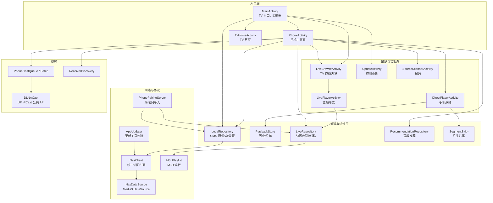

# 片刻（LibreTV Standalone）Code Wiki

> 面向 Android 的原生影音客户端：**手机 + TV 双端**、**本地单机运行**、无自建服务端。
> 内容来自用户导入的 CMS JSON 接口，直播来自 M3U 订阅，播放由 Media3/ExoPlayer 完成，投屏由内置 UPnPCast 完成。

本 Wiki 面向希望阅读、维护或二次开发本项目的工程师，系统说明项目架构、模块职责、关键类与函数、依赖关系、数据存储、播放链路、投屏与更新机制，以及构建运行方式。

---

## 1. 项目概览

| 项目 | 值 |
| --- | --- |
| 应用名 | 片刻（Pianke） |
| 源码仓库 | `github.com/if-lensman/libretv-standalone`（Gitee 镜像 `xdmdpz/libretv-standalone`） |
| 开发语言 | Java（主体）+ Kotlin（手机主界面、投屏辅助、UPnPCast） |
| 构建体系 | Gradle 8.9（wrapper）+ Android Gradle Plugin 8.7.3，Kotlin 1.9.24，JDK 17 |
| SDK | compileSdk 35 / targetSdk 35 / minSdk 23 |
| applicationId | `family.libretv.standalone` |
| namespace | `family.libretv.tv` |
| 版本 | `0.21.0-standalone`，versionCode `58` |
| 许可 | AGPL-3.0-or-later；UPnPCast 模块为 MIT |

### 核心能力

- **多源聚合搜索**：并发请求多个 CMS JSON 采集接口（Apple CMS `ac=videolist`），合并去重并按相关性排序。
- **TV / 手机双入口**：同一 APK 依据 `UiModeManager` 自动分流到手机界面或 TV 界面。
- **点播播放**：Media3 ExoPlayer + 自定义 `NasDataSource`，支持续播、选集、字幕、倍速、手势、遥控快进快退。
- **直播播放**：M3U 订阅、多线路合并与冷却切换、有界恢复（RecoveryPolicy + Watchdog）。
- **片头片尾记忆**：按剧名保存片头/片尾时间点，自动跳过且可取消。
- **DLNA 投屏**：设备发现、单集/队列/批量投屏、断线重连、音量与进度轮询。
- **扫码 / 局域网导入**：手机扫描二维码或打开局域网表单页，把来源配置发送到电视。
- **自更新**：GitHub Releases / Gitee 镜像 / 公共加速代理三条通道，下载后校验大小、SHA-256、包名、版本码与签名。

---

## 2. 文档索引

| 文档 | 内容 |
| --- | --- |
| [01-architecture.md](01-architecture.md) | 整体分层架构、启动与导航流程、异步模型、数据流、关键设计决策 |
| [02-modules.md](02-modules.md) | 模块/包职责清单、模块间依赖关系、`upnpcast` 子模块结构 |
| [03-core-classes.md](03-core-classes.md) | 关键类与关键函数说明（入口、UI、数据、网络、投屏、工具） |
| [04-data-storage.md](04-data-storage.md) | SharedPreferences 清单、Key 生成规则、容量上限、安全存储 |
| [05-playback.md](05-playback.md) | 点播链路、直播链路、播放器参数、续播、片头片尾、手势与字幕 |
| [06-casting.md](06-casting.md) | UPnPCast 架构、投屏队列/批量、重连、局域网配对与二维码 |
| [07-update.md](07-update.md) | 更新通道、清单格式、校验链、安装流程、旧包兼容入口 |
| [08-build-run.md](08-build-run.md) | 环境要求、依赖、构建命令、Gradle 属性、测试、发布流程、常见问题 |

---

## 3. 技术栈与依赖

### 3.1 应用模块依赖（[app/build.gradle](../../app/build.gradle)）

| 依赖 | 版本 | 用途 |
| --- | --- | --- |
| `project(':upnpcast')` | 本地模块 | DLNA 投屏 |
| `kotlinx-coroutines-android` | 1.8.1 | 手机端异步（`PhoneActivity`、投屏队列） |
| `androidx.media3:media3-exoplayer` | 1.9.4 | 播放器内核 |
| `androidx.media3:media3-exoplayer-hls` | 1.9.4 | HLS（m3u8）直播/点播 |
| `androidx.media3:media3-ui` | 1.9.4 | `PlayerView`、`SubtitleView`、`TimeBar` |
| `com.google.zxing:core` | 3.3.3 | 二维码生成与识别 |
| `androidx.core:core` | 1.8.0 | 兼容工具、WindowInsets |
| `androidx.recyclerview:recyclerview` | 1.3.0 | TV 直播/列表 |
| `junit:junit` | 4.13.2 | JVM 单元测试 |
| `androidx.test:runner` | 1.6.2 | 仪器测试 |

### 3.2 运行时权限（[AndroidManifest.xml](../../app/src/main/AndroidManifest.xml)）

`INTERNET`、`ACCESS_NETWORK_STATE`、`MODIFY_AUDIO_SETTINGS`、`CAMERA`（仅扫码页申请）、`REQUEST_INSTALL_PACKAGES`（自更新安装）。

`allowBackup=false`，更新 APK 通过 `FileProvider`（`${applicationId}.updates`）共享。

---

## 4. 源码目录

```text
libretv-standalone/
├── app/                                  Android 应用模块
│   ├── build.gradle                      编译配置、依赖、prepareSourceAssets 任务
│   └── src/
│       ├── main/
│       │   ├── java/family/libretv/tv/   全部业务源码（按职责命名，无子包）
│       │   ├── res/                      布局、图标、主题、drawable
│       │   └── AndroidManifest.xml       Activity / Receiver / FileProvider 声明
│       ├── test/java/family/libretv/tv/  JVM 单元测试
│       └── androidTest/                  仪器测试
├── third-party/upnpcast/                 内置 DLNA 投屏库（Kotlin，MIT）
├── docs/                                 设计、发布、兼容性文档（本 Wiki 在 docs/wiki）
├── local/                                本地真实源目录（默认不入源码）
├── scripts/                              发布与镜像脚本（prepare-release.py 等）
├── gradle/ + gradlew                     构建包装器与版本目录
├── settings.gradle                       include ':app'、':upnpcast'
└── build.gradle                          AGP / Kotlin 插件版本
```

> 说明：包名保留了历史上的 `tv` 后缀与 `Nas*` 命名。0.21.0 起默认以 **单机模式** 运行，`NasClient` 只是统一的“内容访问门面”，实际由 `LocalRepository` 实现，不再需要 NAS 服务端。详见 [01-architecture.md](01-architecture.md#4-单机模式与-nas-命名的关系)。

---

## 5. 架构速览



---

## 6. 快速开始

```bash
# 调试构建（跳过本地真实源，使用空默认源）
./gradlew -PincludeLocalSources=false :app:assembleDebug

# 单元测试 + Lint
./gradlew -PincludeLocalSources=false :app:testDebugUnitTest :app:lintDebug
```

产物：`app/build/outputs/apk/debug/app-debug.apk`。安装后首次进入需在“视频来源”中添加 CMS 接口地址或扫码导入。

完整环境要求、属性开关与发布流程见 [08-build-run.md](08-build-run.md)。
